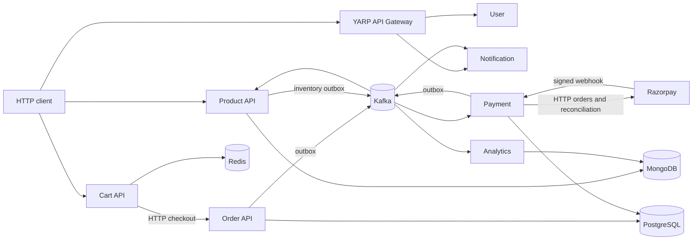

# E-Commerce Microservices

A .NET 10 backend portfolio project exploring a distributed commerce system with a YARP gateway, seven services, Kafka messaging, PostgreSQL, MongoDB and Redis.

**Portfolio:** [PNG overview](docs/freelancer-portfolio.png) | [Animated GIF](docs/freelancer-portfolio.gif) | [PDF case study](docs/freelancer-portfolio.pdf) | [Web case study](docs/freelancer-portfolio.html) | [Architecture](docs/architecture.md)

**Status: work in progress, not production-ready.** Isolated checkout and failure-recovery tests pass with a local payment-provider stub. Product transactional inventory and Payment reconciliation are implemented in source but have not been deployed to the existing stack. MongoDB migration, dependency advisories and real Razorpay sandbox testing remain outstanding. See [validation and restoration](docs/architecture.md#validation-and-restoration).


## Services at a glance

| Component | Responsibility and representative functionality | Storage / integration |
| --- | --- | --- |
| User | Registration, login, user management and roles | PostgreSQL, Kafka |
| Product | Catalog reads and admin product creation; order-event consumer | MongoDB, Kafka |
| Cart | Read/update cart and initiate checkout | Redis; HTTP client to Order |
| Order | Create orders with an idempotency key and publish order events | PostgreSQL, Kafka outbox and saga consumer |
| Payment | Payment processing and Razorpay webhook endpoint | PostgreSQL, Kafka outbox, Razorpay |
| Notification | Notification reads and event consumers | MongoDB, Kafka |
| Analytics | Event ingestion and reporting projection | MongoDB, Kafka, PostgreSQL reporting |
| API Gateway | YARP proxy and user/notification aggregator | HTTP, Kafka |

## Architecture



This diagram describes source-level integration points, not a verified end-to-end deployment. Gateway proxy coverage depends on the configured routes; it must not be assumed to proxy every service. For messaging details and caveats, see [architecture](docs/architecture.md).

## Technology and layout

- ASP.NET Core / .NET 10; individual `.slnx` solutions; layered Domain, Application, Infrastructure and API projects.
- Kafka event consumers and outbox publishers; Redis cart; PostgreSQL and MongoDB persistence.
- Docker Compose for local infrastructure, YARP gateway, observability packages and Razorpay integration.
- `services\`: service projects; `shared\ECommerce.Shared\`: shared contracts and infrastructure; `gateway\`: gateway; `docker\`: Compose and initialization assets; `docs\`: architecture and portfolio.

The current Order-to-Payment flow uses Kafka, not gRPC. Razorpay order creation uses its HTTP API, and signed HTTP webhooks report payment events. gRPC may be appropriate for a separate internal synchronous API, but cannot replace the provider's HTTP integration or asynchronous notifications.

## Getting started safely

1. Install the .NET 10 SDK and Docker Desktop. Start Docker before attempting Compose commands.
2. Provision your own development configuration and credentials outside source control. The published branch was sanitized, but ignored local files and older histories can still contain secrets; review any files and history before publishing, and rotate exposed credentials. Do not copy their values into documentation or public GitHub.
3. Review [restoration instructions and known limitations](docs/architecture.md#validation-and-restoration). The older `STEP_BY_STEP_GUIDE.md` is historical and does not reliably match the current project layout.
4. Check Compose configuration without displaying resolved secrets:

   ```powershell
   docker compose -f .\docker\docker-compose.yml config --quiet
   ```

5. After configuring dependencies, build an individual solution, for example:

   ```powershell
   dotnet build .\services\OrderService\OrderService.slnx
   ```

Do not treat this as a turnkey deployment guide: database schemas, secret management, infrastructure startup, payment provider configuration and service-to-service flows still need verification. Product's transactional inventory consumer requires a MongoDB replica set or sharded cluster; the existing main Compose configuration uses standalone MongoDB and must be migrated with a reviewed data and credential plan before starting the updated Product image. Do not remove the existing database volume.

## API overview

Service-local endpoints include `/api/users`, `/api/auth`, `/api/products`, `/api/cart`, `/api/orders`, `/api/payments`, `/api/notifications` and `/api/analytics`. Individual endpoint policies and request contracts are defined in each service's `Endpoints` folder. Order creation requires `Idempotency-Key`; cart checkout generates one if omitted. Product creation and analytics access have admin policies. Payment webhooks verify a Razorpay signature. Review authorization and ownership checks before exposing any endpoint publicly.

## Validation and limitations

Run the seven xUnit projects with `dotnet test .\tests\ECommerce.Tests.slnx`. With Docker Desktop running, `dotnet test .\tests\ProductService.Infrastructure.Tests\ProductService.Infrastructure.Tests.csproj` runs C# inventory transaction tests on an isolated MongoDB replica set. The existing Python checkout harness (`python .\tests\ECommerce.Tests.Integration\run_checkout_saga.py`) covers broader end-to-end flows and has not yet been replaced by C#. It uses a payment-provider stub, not Razorpay itself. Product's transactional inventory change requires a migration for existing deployments; a background reconciler checks provider orders for uncertain and pending payments, but missing or conflicting results need operator attention. User and Notification retain critical/high package advisories. See [validation and restoration](docs/architecture.md#validation-and-restoration).

## Author

Pauanesh Kumar | [GitHub](https://github.com/Pauanesh-Kumar)
