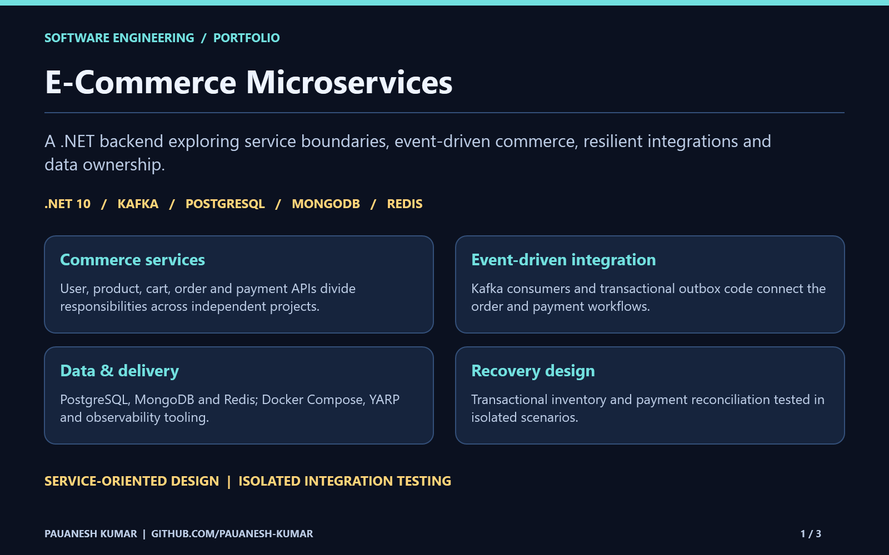
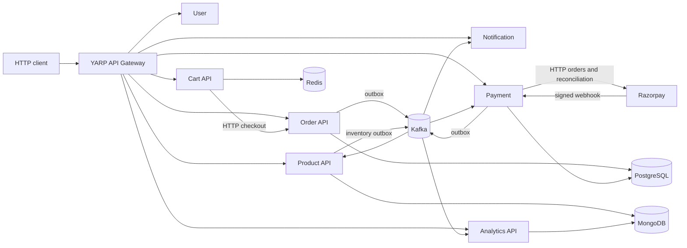

# E-Commerce Microservices

A self-directed **.NET 10** backend that models a complete online shop as seven focused services behind a YARP (Yet Another Reverse Proxy) gateway. It uses Kafka for event-driven messaging, PostgreSQL, MongoDB and Redis for data, and a Razorpay payment integration. The project concentrates on the hard parts of distributed commerce: duplicate messages, uncertain payments and consistent stock.

**Project assets:** [PNG overview](docs/freelancer-portfolio.png) | [Animated GIF](docs/freelancer-portfolio.gif) | [PDF case study](docs/freelancer-portfolio.pdf) | [Web case study](docs/freelancer-portfolio.html) | [Architecture](docs/architecture.md)



## Highlights

- **Seven services and a gateway**, each owning its own data and built as Domain, Application, Infrastructure and API projects.
- **Reliable messaging:** transactional outbox publishers, inbox deduplication and exponential-backoff consumers on Kafka.
- **Idempotent checkout:** order creation is keyed by an `Idempotency-Key`, so retries never create duplicate orders.
- **Transactional inventory:** stock reservation, per-order state, inbox and outbox change together in one MongoDB transaction.
- **Payment resilience:** durable payment intent, signature-verified Razorpay webhooks and a background reconciler that confirms provider state.
- **Failure-tested:** seven xUnit (a .NET unit-testing framework) projects plus a Docker-based harness that rehearses restarts, duplicates and database failures.

## Services at a glance

| Component | Responsibility | Storage / integration |
| --- | --- | --- |
| User | Registration, login, user management and roles | PostgreSQL, Kafka |
| Product | Catalog reads, admin product creation, transactional inventory | MongoDB, Kafka |
| Cart | Read and update cart, initiate checkout | Redis; HTTP client to Order |
| Order | Idempotent order creation, saga consumer, order events | PostgreSQL, Kafka outbox and inbox |
| Payment | Payment processing, Razorpay webhook, reconciliation | PostgreSQL, Kafka outbox, Razorpay |
| Notification | Notification reads and event consumers | MongoDB, Kafka |
| Analytics | Event ingestion and reporting projection | MongoDB, Kafka, PostgreSQL reporting |
| API Gateway | YARP proxy, authentication, health checks, aggregation | HTTP, Kafka |

## Architecture



Every client request enters through the YARP gateway (the only published port); backend services are internal and the gateway allows CORS only for the Angular origin. Cart starts checkout over HTTP; Order, Product, Payment, Notification and Analytics then cooperate through Kafka events. Order users come from the JWT, and analytics reports are served at `/api/analytics/reports/*` (Admin). Details are in [architecture](docs/architecture.md).

## Technology and layout

- ASP.NET Core on .NET 10, one `.slnx` solution per service, Kestrel hosting.
- Kafka consumers and outbox publishers; Redis cart; PostgreSQL and MongoDB persistence.
- Docker Compose for local infrastructure, YARP gateway, OpenTelemetry observability packages and Razorpay integration.
- `services\` service projects, `shared\ECommerce.Shared\` shared contracts and infrastructure, `gateway\` gateway, `docker\` Compose and initialization assets, `docs\` architecture and portfolio, `tools\` development utilities.

## Getting started

1. Install the .NET 10 SDK (Software Development Kit) and Docker Desktop, then start Docker.
2. Keep your own development credentials in local configuration outside source control.
3. Check the Compose configuration without printing resolved values:

   ```powershell
   docker compose -f .\docker\docker-compose.yml config --quiet
   ```

4. Create any missing Kafka topics without touching existing ones:

   ```powershell
   docker compose -f .\docker\docker-compose.yml run --rm --no-deps kafka-init
   ```

5. Build a service, for example:

   ```powershell
   dotnet build .\services\OrderService\OrderService.slnx
   ```

Product uses MongoDB transactions for inventory, so run its MongoDB as a replica set (the test suite shows a single-node example).

## API overview

Service-local endpoints include `/api/users`, `/api/auth`, `/api/products`, `/api/cart`, `/api/orders`, `/api/payments`, `/api/notifications` and `/api/analytics`. Request contracts live in each service's `Endpoints` folder. Order creation requires `Idempotency-Key`; cart checkout generates one if omitted. Product creation and analytics access use admin policies, and payment webhooks verify a Razorpay signature.

## Testing

```powershell
# Seven xUnit projects
dotnet test .\tests\ECommerce.Tests.slnx

# Product inventory transactions on a disposable MongoDB replica set (Docker required)
dotnet test .\tests\ProductService.Infrastructure.Tests\ProductService.Infrastructure.Tests.csproj

# End-to-end checkout harness with disposable infrastructure and a payment-provider stub
dotnet run --project .\tests\ECommerce.Tests.Integration\ECommerce.Tests.Integration.csproj
```

The harness passed checkout, insufficient stock, failed-then-captured payment, missed-webhook reconciliation, database failures, process restarts, concurrent webhooks and duplicate event replay on 2026-11-23.

Regenerate the overview assets on Windows x64:

```powershell
dotnet run --project .\tools\PortfolioGenerator\PortfolioGenerator.csproj --configuration Release
```

## Architecture and development

Designed and developed by **Pauanesh Kumar**, Senior Technical Leader & Architect | [GitHub](https://github.com/Pauanesh-Kumar)
