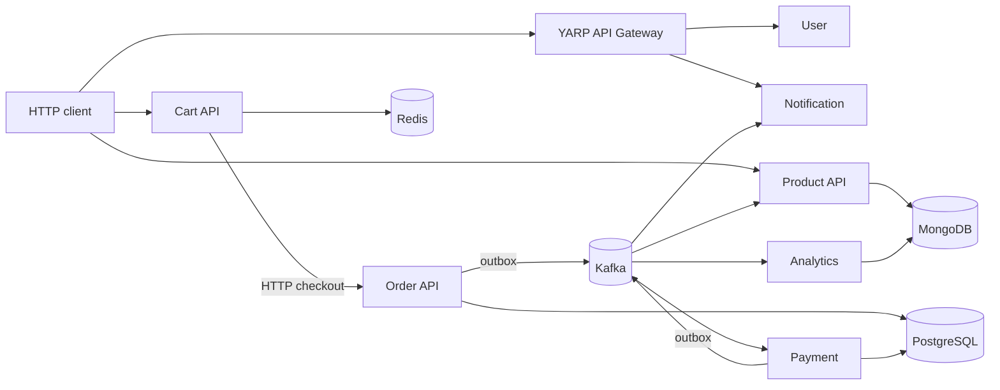

# E-Commerce Microservices

A .NET 10 backend portfolio project exploring a distributed commerce system with a YARP gateway, seven services, Kafka messaging, PostgreSQL, MongoDB and Redis.

**Portfolio:** [PNG overview](docs/freelancer-portfolio.png) | [Animated GIF](docs/freelancer-portfolio.gif) | [PDF case study](docs/freelancer-portfolio.pdf) | [Web case study](docs/freelancer-portfolio.html) | [Architecture](docs/architecture.md)

**Status: work in progress, not production-ready.** An isolated checkout saga test passes with a local payment-provider stub. Dependency advisories and failure-recovery gaps remain; a real Razorpay sandbox has not been tested. See [validation and restoration](docs/architecture.md#validation-and-restoration).

## Services at a glance

| Component | Responsibility and representative functionality | Storage / integration |
| --- | --- | --- |
| User | Registration, login, user management and roles | PostgreSQL, Kafka |
| Product | Catalog reads and admin product creation; order-event consumer | MongoDB, Kafka |
| Cart | Read/update cart and initiate checkout | Redis; HTTP client to Order |
| Order | Create orders with an idempotency key and publish order events | PostgreSQL, Kafka outbox and saga consumer |
| Payment | Payment processing and Razorpay webhook endpoint | PostgreSQL, Kafka outbox, Razorpay |
| Notification | Notification reads and event consumers | MongoDB, Kafka |
| Analytics | Event ingestion and reporting projection | MongoDB, Kafka, PostgreSQL reporting |
| API Gateway | YARP proxy and user/notification aggregator | HTTP, Kafka |

## Architecture



This diagram describes source-level integration points, not a verified end-to-end deployment. Gateway proxy coverage depends on the configured routes; it must not be assumed to proxy every service. For messaging details and caveats, see [architecture](docs/architecture.md).

## Technology and layout

- ASP.NET Core / .NET 10; individual `.slnx` solutions; layered Domain, Application, Infrastructure and API projects.
- Kafka event consumers and outbox publishers; Redis cart; PostgreSQL and MongoDB persistence.
- Docker Compose for local infrastructure, YARP gateway, observability packages and Razorpay integration.
- `services\`: service projects; `shared\ECommerce.Shared\`: shared contracts and infrastructure; `gateway\`: gateway; `docker\`: Compose and initialization assets; `docs\`: architecture and portfolio.

## Getting started safely

1. Install the .NET 10 SDK and Docker Desktop. Start Docker before attempting Compose commands.
2. Provision your own development configuration and credentials outside source control. The local Git history contains tracked environment/backup files and settings that must be reviewed and sanitized before publishing; `.gitignore` does not remove tracked files or history. Do not copy their values into documentation or public GitHub.
3. Review [restoration instructions and known limitations](docs/architecture.md#validation-and-restoration). The older `STEP_BY_STEP_GUIDE.md` is historical and does not reliably match the current project layout.
4. Check Compose configuration without displaying resolved secrets:

   ```powershell
   docker compose -f .\docker\docker-compose.yml config --quiet
   ```

5. After configuring dependencies, build an individual solution, for example:

   ```powershell
   dotnet build .\services\OrderService\OrderService.slnx
   ```

Do not treat this as a turnkey deployment guide: database schemas, secret management, infrastructure startup, payment provider configuration and service-to-service flows still need verification.

## API overview

Service-local endpoints include `/api/users`, `/api/auth`, `/api/products`, `/api/cart`, `/api/orders`, `/api/payments`, `/api/notifications` and `/api/analytics`. Individual endpoint policies and request contracts are defined in each service's `Endpoints` folder. Order creation requires `Idempotency-Key`; cart checkout generates one if omitted. Product creation and analytics access have admin policies. Payment webhooks verify a Razorpay signature. Review authorization and ownership checks before exposing any endpoint publicly.

## Validation and limitations

Run the seven xUnit projects with `dotnet test .\tests\ECommerce.Tests.slnx`. With Docker Desktop running, `python .\tests\ECommerce.Tests.Integration\run_checkout_saga.py` exercises isolated checkout, compensation, a Kafka broker outage, an Order database failure followed by retry, and an abrupt Order-process restart. It uses disposable test data and a local payment-provider stub, not Razorpay itself. Order's consumer retries failed events with backoff; Product, Payment and Analytics still need crash-safe processing. User and Notification retain critical/high package advisories. See [validation and restoration](docs/architecture.md#validation-and-restoration).

## Author

Pauanesh Kumar | [GitHub](https://github.com/Pauanesh-Kumar)
