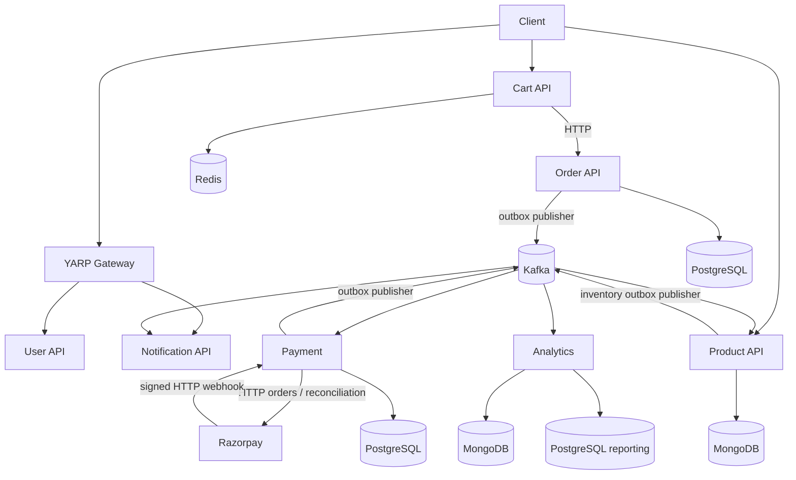

# Architecture

This document explains how the E-Commerce Microservices system is organized, how an order moves through it, and which design patterns keep it consistent.

## 1. System context



The gateway reads YARP (Yet Another Reverse Proxy) routes from configuration and also aggregates User and Notification data. Cart reaches Order over HTTP, and Order to Payment runs asynchronously over Kafka. Razorpay order creation uses its HTTP API, and its signed webhooks report payment events.

## 2. Services

| Component | Capabilities |
| --- | --- |
| User | Registration, login, user management; GraphQL and gRPC (Google Remote Procedure Call) registration |
| Notification | Notification reads and Kafka consumers for user, order and payment events |
| Product | Catalog read and create endpoints, MongoDB repository, order-event consumer, inventory publisher |
| Cart | Redis cart repository, HTTP order client, checkout endpoint with generated idempotency key |
| Order | PostgreSQL repository, idempotency record, outbox and saga consumer; order, idempotency key and outbox row saved together |
| Payment | PostgreSQL, Kafka request consumer and outbox, Razorpay gateway and webhook |
| Analytics | Kafka consumer, MongoDB event storage, timed PostgreSQL reporting projection |
| Gateway | YARP configuration, authentication, health checks, Scalar API docs, aggregation |
| Shared | Messaging, models, correlation, resilience, OpenTelemetry and Redis helpers |

## 3. An order, step by step

1. **Checkout.** Cart reads the authenticated user and calls Order through its configured HTTP client, forwarding the bearer token.
2. **Order creation.** Order requires an `Idempotency-Key`, checks for a prior key, then saves the order, the key and an `order-created` outbox row in one database save.
3. **Fan-out.** The outbox publisher sends the event to Kafka. Product reserves stock, Payment opens a provider order, and Notification and Analytics record the event.
4. **Payment.** Razorpay reports outcomes through signed webhooks. A reconciler confirms uncertain payments with the provider. Payment publishes outcomes through its own outbox.
5. **Completion.** Order's saga consumer saves its inbox entry, the order transition and the next outbox row in one scoped context, then commits the Kafka offset.

## 4. Reliability patterns

| Pattern | How it is applied |
| --- | --- |
| Idempotency | Database-backed idempotency keys on order creation |
| Transactional outbox | State change and outgoing event commit together; separate publishers deliver at least once with stable event IDs |
| Inbox deduplication | Order, Payment, Product and Analytics record event IDs; Analytics also uses a unique partial MongoDB index on `SourceEventId` |
| Transactional inventory | Product commits stock change, per-order reservation state, inbox and outbox in one MongoDB transaction with snapshot reads and majority writes |
| Payment intent | Payment saves an `Initiating` record and inbox entry before calling the provider, so a replay never creates a second provider order |
| Reconciliation | A hosted worker searches Razorpay orders by receipt, verifies receipt, amount and currency, and checks captured payments before emitting the normal outcome |
| Retry policy | Consumers retry with exponential backoff up to 30 seconds and commit offsets only after success; the Razorpay circuit breaker and timeouts guard HTTP calls |
| Concurrency | A status concurrency token prevents two successful payment transitions from both committing |

Reconciliation runs every 60 seconds by default (`PaymentReconciliation:IntervalSeconds`) for payments at least 120 seconds old (`MinimumAgeSeconds`, minimum 30).

## 5. Data and deployment

- Order and Payment use Npgsql (PostgreSQL) contexts with EF (Entity Framework) Core initial migrations, applied on startup in Development.
- Product and Analytics use MongoDB; Cart uses Redis; Analytics also writes a PostgreSQL reporting schema from a hosted service.
- Product's transactions need a MongoDB replica set; the integration tests use a disposable single-node replica set.
- Docker Compose runs the services, databases, Kafka and monitoring. `kafka-init` creates topics and the Mongo initialization scripts create application users on a fresh volume.

## 6. Validation

- A fresh `dotnet build` passes all seven services, Shared and Gateway.
- Local containers reported healthy, and authenticated reads of cart, order, payment, analytics and notification data returned HTTP 200 through the gateway.
- Seven xUnit (a .NET unit-testing framework) projects cover domain behavior, checkout, payment processing, validation and analytics query limits:

  ```powershell
  dotnet test .\tests\ECommerce.Tests.slnx
  ```

- Product inventory tests run on a disposable MongoDB replica set and cover rollback on outbox failure, duplicate reservation and release, conflicting event IDs and legacy inbox replay:

  ```powershell
  dotnet test .\tests\ProductService.Infrastructure.Tests\ProductService.Infrastructure.Tests.csproj
  ```

- The checkout harness runs five APIs against disposable Kafka, PostgreSQL, MongoDB replica set, Redis and a Razorpay-compatible stub. On 2026-11-23 it passed checkout, insufficient stock, failed-then-captured payment, missed-webhook reconciliation, database failures, process restarts, concurrent webhooks and duplicate event replay:

  ```powershell
  dotnet run --project .\tests\ECommerce.Tests.Integration\ECommerce.Tests.Integration.csproj
  ```

- The harness also led to improvements in bearer-token forwarding from Cart to Order, MongoDB UUID serialization, the Razorpay `/v1/orders` path and webhook event-ID handling.
- `tools\RazorpaySandboxCheck` verifies read-only Razorpay test-mode access using environment variables, and can create a one-rupee test order on request.

## 7. Working with the repository

1. Check `git status --short --branch`; each service has its own `.slnx`.
2. Keep credentials in local configuration and out of Git and logs.
3. Validate Compose with `docker compose -f .\docker\docker-compose.yml config --quiet`.
4. Build each `.slnx`, run the tests above, and review dependency health with `dotnet list <solution> package --vulnerable --include-transitive`.
5. Regenerate the overview assets on Windows x64 with `dotnet run --project .\tools\PortfolioGenerator\PortfolioGenerator.csproj --configuration Release`; the .NET 10 tool uses WPF (Windows Presentation Foundation) and Segoe UI fonts.

## 8. Glossary

YARP (Yet Another Reverse Proxy), EF (Entity Framework), gRPC (Google Remote Procedure Call), HTTP (Hypertext Transfer Protocol), PNG (Portable Network Graphics), GIF (Graphics Interchange Format), PDF (Portable Document Format).
