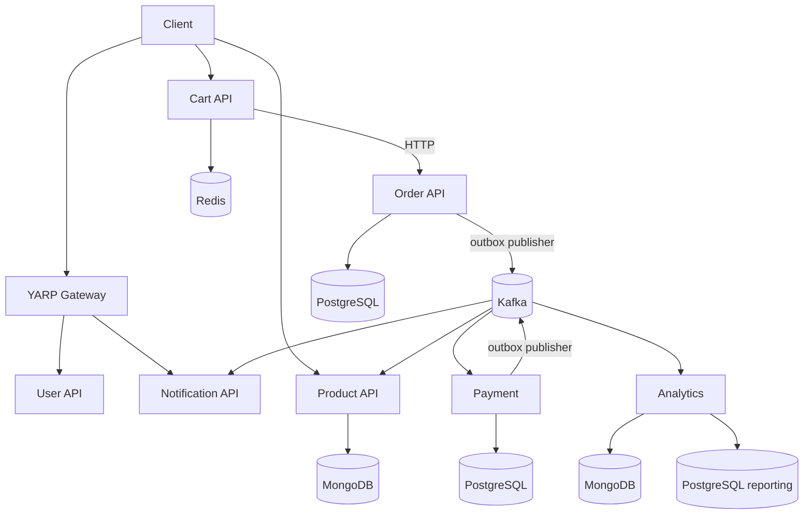

# Architecture, service review and restoration

This document records the checked-in source and the local validation performed on 22 November 2026. Intended architecture and code paths are not proof of working integration or production readiness.

## System context

The gateway reads YARP routes from configuration. Its native aggregator calls downstream services; not every API should be assumed to be reachable through the gateway. The source also contains gRPC and shared contracts, but the reviewed cart-to-order path uses HTTP, not gRPC. Verify any claimed gRPC payment flow before relying on it.

## Service-by-service review

| Component | Source evidence | Build check |
| --- | --- | --- |
| User | `UserEndpoints.cs`: registration, login and user management; API includes GraphQL and gRPC registration. | Fresh restore fails: logging and OpenTelemetry package downgrades. |
| Notification | Notification endpoints and user/order/payment Kafka consumers; direct send endpoint is commented out. | Fresh restore fails: OpenTelemetry package downgrade. |
| Product | Catalog read/create endpoints, MongoDB repository, order-event consumer and product publisher. | Passed, warnings. |
| Cart | Redis cart repository, HTTP order client and checkout endpoint. Checkout generates an idempotency key when absent, so a client must send a stable key for retries. | Passed, warnings. |
| Order | PostgreSQL repository, idempotency record, outbox and saga consumer. `CreateOrderCommand` saves order, idempotency and outbox together. | Passed, warnings. |
| Payment | PostgreSQL, Kafka request consumer/outbox and Razorpay gateway/webhook. | Passed, warnings. |
| Analytics | Kafka consumer, MongoDB event storage and timed PostgreSQL reporting projection. | Passed, warnings. |
| Gateway | YARP configuration, auth, health, Scalar and user/notification aggregation. | Passed, warnings. |
| Shared | Shared messaging, models, correlation, resilience, OpenTelemetry and Redis-related code. Some services also retain service-specific implementations; do not assume all use the shared infrastructure. | Passed, warnings. |

These are build checks, not a comprehensive functional, security or production audit. Restore reported dependency advisory warnings including critical and high severity packages; review the resolved dependency graph and update/test packages before deployment.

## Example order flow in source

1. Cart checkout reads the authenticated user ID and calls its configured Order HTTP client.
2. Order creation requires `Idempotency-Key`; its handler checks for a prior key and writes the order, key and `order-created` outbox row with one save.
3. The Order outbox publisher and saga consumer are registered as hosted services. Product, Payment and other services register Kafka consumers/publishers for their respective event paths.
4. Payment has an endpoint for signature-verified Razorpay webhooks and a payment outbox publisher. Analytics registers a Kafka consumer and a periodic reporting projection.

Event schemas, routing, retries, duplicate handling, authorization and behavior under failures must be tested end to end before describing the flow as reliable. The Order idempotency implementation shown in source is database-backed; do not assume it uses the shared Redis idempotency store.

## Data and deployment

Order and Payment configure Npgsql contexts; Product and Analytics configure MongoDB; Cart configures Redis. Analytics additionally expects an `AnalyticsReportingDb` connection for its reporting projection. The Compose file defines PostgreSQL, MongoDB, Redis, Kafka, service containers, a gateway and observability tools. `docker compose ... config --quiet` passed locally using the existing local configuration; Docker Desktop's engine was unavailable, so container startup and health were not verified. Do not print resolved Compose configuration in shared logs because it can contain secrets.

## Validation and restoration

### Baseline on 22 November 2026

- Installed SDK: `11.0.100`; projects target .NET 10.
- A fresh `dotnet build` passed Shared, Product, Cart, Order, Payment, Analytics and Gateway, with warnings. Earlier User and Notification `--no-restore` builds used cached assets and did not establish that fresh restores worked.
- Product, Cart and Payment instrumentation references were aligned with Shared; the unavailable Shared EF instrumentation version was replaced with the version NuGet had resolved. Cart endpoint injection now uses the registered repository interface. Analytics project references and its configuration-binding dependency were corrected.
- User fresh restore fails with `NU1605` for logging and OpenTelemetry; Notification fresh restore fails with `NU1605` for OpenTelemetry. Both services remain unchanged under the project constraint. Resolve these conflicts with owner approval before claiming a clean full build.
- No tracked migration directories were found for Order, Payment or Analytics. Order and Payment call EF migration APIs, but an applied schema or reproducible migration baseline was not verified. Analytics reporting also contains SQL schema creation in its hosted service.
- No tracked test project files were found in `tests`; no automated or live integration tests were run. Docker engine was unavailable.

### Resume after a Visual Studio restart

1. Open the repository folder and inspect `git status --short --branch`; preserve unrelated local modifications. Each service has its own `.slnx`. The historical `STEP_BY_STEP_GUIDE.md` references older structure and should not be treated as authoritative.
2. **Before public push**, inspect current files *and all reachable Git history* for credentials, archives, backups and sensitive data. The local history includes tracked `.env` files, backup env files, settings files and an archive containing an `.env`. Ignoring a file does not untrack it or remove it from earlier commits. Assume any real credentials in such files require rotation; follow the owner's approved history-sanitization plan. Do not publish this history as-is.
3. Replace committed secrets with protected local configuration and provide a non-secret example configuration only after reviewing all required settings. Ensure every service and Compose receives the correct settings without printing them in logs. The gateway explicitly requires `appsettings.json`, so removing settings requires a deliberate safe replacement.
4. With owner approval, resolve User and Notification package downgrades without suppressing restore errors. Review NU1603 and security advisory warnings, restore all solutions and rebuild. Current project instructions prohibit modifying User and Notification.
5. Start Docker Desktop; validate Compose with `docker compose -f .\docker\docker-compose.yml config --quiet`. Provision local dependencies and databases using reviewed, non-production credentials. Verify migration paths, topic creation, addresses and service configuration; syntax validation alone does not establish operational correctness.
6. Build each individual `.slnx`, then add and run meaningful unit, integration and failure/retry tests. Verify each service's health endpoint, authorization, checkout/idempotency behavior, Kafka event flows, payment webhook and analytics projection against isolated infrastructure.
7. Generate the portfolio assets from the repository root with `python .\docs\generate_portfolio.py` (requires Pillow and Windows Segoe UI fonts). Open the PNG, GIF, PDF and HTML and verify their content after changing project status.
8. Once history is demonstrably safe, authenticate to GitHub and push only an owner-approved branch. Do not rewrite existing history without explicit approval; the public repository was empty at the time of this review.

## Portfolio materials

The assets deliberately present architecture and implementation areas rather than claiming verified production operation or business outcomes. Update their status text whenever build and end-to-end verification results change. The reference repository provides an architecture document, HTML and generated images; this project additionally includes a PDF case study.
