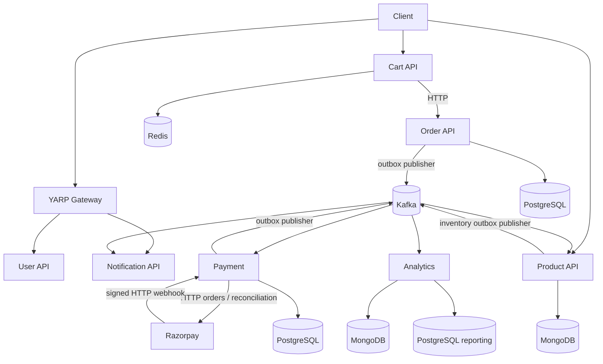

# Architecture, service review and restoration

This document records the local source and validation. Intended architecture and code paths are not proof of working integration or production readiness.

## System context

The gateway reads YARP routes from configuration. Its native aggregator calls downstream services; not every API should be assumed to be reachable through the gateway. The source also contains gRPC and shared contracts, but the reviewed cart-to-order path uses HTTP, not gRPC. Verify any claimed gRPC payment flow before relying on it.

## Service-by-service review

| Component | Source evidence | Build check |
| --- | --- | --- |
| User | `UserEndpoints.cs`: registration, login and user management; API includes GraphQL and gRPC registration. | Passed, warnings. |
| Notification | Notification endpoints and user/order/payment Kafka consumers; direct send endpoint is commented out. | Passed, warnings. |
| Product | Catalog read/create endpoints, MongoDB repository, order-event consumer and product publisher. | Passed, warnings. |
| Cart | Redis cart repository, HTTP order client and checkout endpoint. Checkout generates an idempotency key when absent, so a client must send a stable key for retries. | Passed, warnings. |
| Order | PostgreSQL repository, idempotency record, outbox and saga consumer. `CreateOrderCommand` saves order, idempotency and outbox together. | Passed, warnings. |
| Payment | PostgreSQL, Kafka request consumer/outbox and Razorpay gateway/webhook. | Passed, warnings. |
| Analytics | Kafka consumer, MongoDB event storage and timed PostgreSQL reporting projection. | Passed, warnings. |
| Gateway | YARP configuration, auth, health, Scalar and user/notification aggregation. | Passed, warnings. |
| Shared | Shared messaging, models, correlation, resilience, OpenTelemetry and Redis-related code. Some services also retain service-specific implementations; do not assume all use the shared infrastructure. | Passed, warnings. |

These are build checks, not a comprehensive functional, security or production audit. Restore reported dependency advisory warnings including critical and high severity packages; review the resolved dependency graph and update/test packages before deployment.

## Example order flow in source

1. Cart checkout reads the authenticated user ID and calls its configured Order HTTP client.
2. Order creation requires `Idempotency-Key`; its handler checks for a prior key and writes the order, key and `order-created` outbox row with one save.
3. The Order outbox publisher and saga consumer are registered as hosted services. Product, Payment and other services register Kafka consumers/publishers for their respective event paths.
4. Payment creates a Razorpay order using the provider's HTTP API and accepts signature-verified Razorpay webhooks. It publishes payment outcomes through an outbox. Analytics registers a Kafka consumer and a periodic reporting projection.

The current Order-to-Payment integration is asynchronous Kafka, not gRPC. gRPC is an option for an internal request/response service contract, not a substitute for the provider's protocol or its asynchronous notifications. Razorpay documents [HTTP order creation](https://razorpay.com/docs/api/orders/create/) and [HTTP webhooks](https://razorpay.com/docs/webhooks/); no new gRPC payment endpoint or client is implemented here.

Event schemas, routing, retries, duplicate handling, authorization and behavior under failures must be tested end to end before describing the flow as reliable. The Order idempotency implementation shown in source is database-backed; do not assume it uses the shared Redis idempotency store.

## Data and deployment

Order and Payment configure Npgsql contexts; Product and Analytics configure MongoDB; Cart configures Redis. Analytics additionally expects an `AnalyticsReportingDb` connection for its reporting projection. The main Compose file currently runs Product MongoDB as a standalone instance; the updated Product service intentionally refuses to start against it because inventory transactions need a replica set or sharded cluster. The isolated test uses a disposable single-node replica set. A production replica set needs appropriate replication, authentication, backups and client topology. Order and Payment apply their EF migrations on startup in Development; other environments require a reviewed explicit migration step. Do not print resolved Compose configuration in shared logs because it can contain secrets.

## Validation and restoration

### Local validation

- Installed SDK: `11.0.100`; projects target .NET 10.
- A fresh `dotnet build` passed all seven services, Shared and Gateway, with warnings.
- Shared no longer references unused EF Core and EF instrumentation packages or redundant Microsoft.Extensions packages supplied by the ASP.NET Core framework. Its ASP.NET Core OpenTelemetry instrumentation was aligned with User and Notification, resolving their `NU1605` conflicts without suppressing errors or modifying those services. Cart endpoint injection now uses the registered repository interface. Analytics project references and its configuration-binding dependency were corrected.
- Added Order and Payment EF initial migrations and verified them against the previously empty local databases. Analytics reporting creates its reporting schema in a hosted service; no Analytics EF migration was added.
- Fresh User and Notification images were built, checked in temporary containers, and deployed. Their health checks passed, as did the gateway's `/health`; all seven service containers and the gateway reported healthy. Product catalog and authenticated cart, order, payment, analytics and notification reads returned HTTP 200 through the gateway during local validation. The authenticated reads preceded the final User and Notification replacement.
- The Kafka initialization job was run to create missing saga topics. Missing Product and Analytics MongoDB application users were created in existing local volumes using their configured credentials; no existing users were modified. Product initialization now receives the correct database setting. Mongo initialization scripts run only on a fresh volume; preexisting volumes require a manual, non-destructive user check.
- Analytics driver/BSON versions were aligned after a runtime assembly error. Product now relies on MongoDB's automatically unique `_id` inbox index. Shared Redis registration accepts the existing `Redis:ConnectionString` key and registers the expected interface.
- Seven xUnit projects under `tests` cover selected domain behavior, checkout, payment processing, validation and analytics query limits. Run them with `dotnet test .\tests\ECommerce.Tests.slnx`. User and Notification tests are in that solution without changes to those service directories.
- `dotnet test .\tests\ProductService.Infrastructure.Tests\ProductService.Infrastructure.Tests.csproj` runs a C# xUnit test using a uniquely named disposable MongoDB replica-set container. It tests rollback on an outbox write failure, duplicate reservation and release, conflicting event IDs and legacy inbox replay. Docker is required.
- `dotnet run --project .\tests\ECommerce.Tests.Integration\ECommerce.Tests.Integration.csproj` runs five locally built APIs with separate disposable Kafka, PostgreSQL, a single-node MongoDB replica set, Redis and a local Razorpay-compatible stub hosted by Kestrel. The C# harness passed checkout, insufficient stock, failed then captured payment, missed webhook reconciliation, database failures, process restarts, concurrent webhooks and duplicate event replay on 2026-11-23. This does not cover every crash or rebalance boundary. Pausing the broker does not test a broker crash or persistent Kafka storage. It does not exercise the real Razorpay sandbox, the gateway or Notification.
- The isolated flow exposed and corrected bearer-token forwarding from Cart to Order, Product MongoDB UUID serialization, the Razorpay `/v1/orders` path, and webhook event-ID handling. Before deploying to existing MongoDB data, check whether product IDs and inbox IDs use standard UUID representation; other legacy representations may require a reviewed migration.
- The five in-scope service APIs and gateway were upgraded for high/critical advisories in GraphQL, OpenAPI, MongoDB compression, AutoMapper and Order design-time cryptography. User and Notification remain unchanged and retain critical/high advisories; other moderate advisories remain. Re-run `dotnet list <solution> package --vulnerable --include-transitive` to verify current results.
- Order's saga consumer saves the inbox in the same scoped EF Core context and save as the order transition and outbox; it commits Kafka only after success. Failures seek back to the failed record with exponential delays up to 30 seconds. A missing event ID or poison event will block progress on its partition until corrected; monitor consumer lag and logs and do not manually advance offsets without reconciling the order. Rebalances, concurrent replicas and crashes at other processing boundaries still need dedicated fault-injection tests.
- Analytics uses a unique partial MongoDB index on `SourceEventId`, inserts before committing the Kafka offset, and seeks back with exponential backoff on a failed write. A valid 16-byte `eventId` header identifies redeliveries across Kafka offsets; records without it use topic, partition and offset, so republishing such records at a different offset can still duplicate them. Existing records without `SourceEventId` are not retroactively deduplicated. A conflicting identity with different payload blocks processing and requires investigation. If the index cannot be created, consumption retries without advancing offsets; monitor logs and consumer lag. Test concurrent consumers and crash/rebalance boundaries before production.
- Product's new consumer commits inventory changes, per-order reservation state, inbox and an outbox event in one MongoDB transaction with snapshot reads and majority writes. A separate publisher retries outbox records and uses the stored event ID on every publish; delivery is at least once, so downstream consumers must deduplicate. A duplicate order with different quantities or an event ID with a different payload is rejected. Missing reservation state on a release or a legacy inbox replay blocks the partition for manual reconciliation. Multiple replicas, broker rebalances, crash boundaries and a migration from historical reservations still require production validation.
- Payment saves an `Initiating` payment and inbox entry together before the create-order call. Replay will not call the provider again or publish a failure. A hosted reconciler periodically searches Razorpay's paginated order list by receipt, verifies exact receipt, amount and currency, attaches a unique matching order, and checks paid orders for an exactly matching captured payment before emitting the normal transactional payment outcome. No match, duplicate matches, mismatches and provider errors do not trigger another POST or failure; monitor logs and payment age and investigate manually. The consumer requires a 16-byte event ID and retries failed records with backoff; malformed or conflicting events can block a partition. Existing orphan inbox records from older versions are not repaired. Multiple replicas, scaling and all crash/rebalance boundaries need further tests.
- `payment.failed` reports a single failed attempt, not a failed provider order: Payment records its event ID without cancelling the order or releasing stock. A later captured attempt can confirm it. There is currently no automatic expiry/cancellation policy for an order that is never paid; reserved stock can remain held and needs operator attention. The status concurrency token prevents concurrent successful transitions from both committing. Conflicting captures and historical terminal failures still require investigation; the reconciler does not repair previously cancelled orders or initiate refunds.
- Razorpay's HTTP circuit breaker and timeouts remain active. Create-order POST retries remain disabled because the result may be ambiguous. Reconciliation reads use a separate retrying client; `PaymentReconciliation:IntervalSeconds` defaults to 60 and `MinimumAgeSeconds` to 120 (minimum 30). Reconciliation scans old pending payments and may generate provider traffic proportional to their number; rate limits, scheduling, monitoring and multi-replica behavior need a production review. A real Razorpay test-mode account and webhook endpoint are required for sandbox validation. Never put its credentials in Git or logs.
- User's `HotChocolate.Language` (critical), `Microsoft.OpenApi`, `AutoMapper`, `System.Security.Cryptography.Pkcs` and `System.Security.Cryptography.Xml` (high), and Notification's `HotChocolate.Language` (critical), `Microsoft.OpenApi` and `Snappier` (high) remain unresolved. Dependency advisories change over time; rerun the vulnerability query before release.

### Payment and inventory incident procedure

1. Treat an `Initiating` payment, provider timeout, interrupted Payment process or stuck order as **unknown**, not proof of failure. Monitor `Initiating` and aged `Pending` rows and reconciliation errors. The worker may attach a verified provider order or process a verified capture, but it does not recreate a missing provider order or repair a historical cancellation. Do not retry a create-order POST, manually advance Kafka offsets, release inventory or issue a refund until the provider and internal states have been reconciled. Older software could have published a failure on an ambiguous provider response; investigate historical records separately.
2. In the correct Razorpay account and mode, inspect the internal order ID, the Payment database and inbox/outbox, and provider webhook delivery history. The adapter sends the internal order ID as `receipt`. The [Razorpay Orders list API](https://razorpay.com/docs/api/orders/fetch-all/) supports receipt filtering and pagination; verify an exact receipt match, amount, currency and payment status. A receipt filter matches containing values, not necessarily an exact value. Absence from a single page or a temporary provider error is not proof that no order exists.
3. For Product, inspect the source event, legacy `inbox`, `inventory_inbox`, `inventory_reservations`, `inventory_outbox`, stock quantities and downstream event history before any replay. The legacy inbox may say processed even when reservation or publication failed. New releases without a matching transactional reservation are deliberately rejected. There is no automated migration or safe repair for historical stock reservations; back up and reconcile affected data using an operator-reviewed plan.
4. Record the incident, evidence and operator-approved recovery. Do not place API keys, webhook secrets, full customer payment details or raw provider responses in tickets, logs or source control. No operator repair procedure is implemented or validated by this repository.

### Razorpay sandbox validation checklist

Use a separate test-mode account, isolated staging databases and a public HTTPS webhook endpoint. Configure test keys and webhook secret via local secret storage; never paste credentials into Git or chat. The running Payment container's configured test key returned HTTP 401 on a read-only Orders API check on 2026-11-23; replace it locally with valid test credentials before proceeding. The C# tool `dotnet run --project .\tools\RazorpaySandboxCheck\RazorpaySandboxCheck.csproj` reads `Razorpay__KeyId` and `Razorpay__KeySecret` from its process environment, requires an `rzp_test_` key, and verifies read-only API access. Pass `-- --create-order` only when intentionally creating a 1 INR test order; retain its printed receipt if the response is ambiguous. It verifies order creation and read-back, but does not capture payment, call the application or verify webhook delivery. Confirm the Orders API endpoint and webhook event subscriptions using [Razorpay's documentation](https://razorpay.com/docs/webhooks/). Test successful and declined payments, valid and invalid signatures, repeated and out-of-order webhooks, provider timeouts and process restarts. Compare internal and provider state after each case. No real sandbox payment or webhook run has been verified here.

### Resume after a Visual Studio restart

1. Open the repository folder and inspect `git status --short --branch`; preserve unrelated local modifications. Each service has its own `.slnx`. The historical `STEP_BY_STEP_GUIDE.md` references older structure and should not be treated as authoritative.
2. **Before public push**, inspect current files and all reachable Git history for credentials, archives, backups and sensitive data. Older local history contained tracked configuration and archives; the sanitized `main` branch excludes them. Ignored local files can still contain secrets; rotate any credentials that may have been exposed.
3. Replace committed secrets with protected local configuration and provide a non-secret example configuration only after reviewing all required settings. Ensure every service and Compose receives the correct settings without printing them in logs. The gateway explicitly requires `appsettings.json`, so removing settings requires a deliberate safe replacement.
4. Review NU1603 and security advisory warnings, restore all solutions and rebuild. Current project instructions prohibit modifying User and Notification, which still have critical/high package advisories. The earlier package downgrade fix is in `shared\ECommerce.Shared\ECommerce.Shared.csproj`.
5. Start Docker Desktop; validate Compose with `docker compose -f .\docker\docker-compose.yml config --quiet`. For an existing installation, run `docker compose -f .\docker\docker-compose.yml run --rm --no-deps kafka-init` to create missing topics without deleting existing ones. Inspect existing databases and back up data before applying migrations; never recreate or remove volumes merely to rerun Mongo initialization.
6. Build each individual `.slnx`, run `dotnet test .\tests\ECommerce.Tests.slnx`, and, with Docker running, run `dotnet run --project .\tests\ECommerce.Tests.Integration\ECommerce.Tests.Integration.csproj`. The test tool starts and removes its own uniquely named Docker project and temporary data; it intentionally pauses only that project's Kafka broker. Add crash/rebalance tests for each consumer and real sandbox tests before relying on Kafka recovery or provider integration. Liveness does not check all external dependencies.
7. Previous local service images reported healthy; this does not verify later source changes were deployed. Payment's `Initiating` status uses the existing column but older binaries may not deserialize it; plan rollback and prevent mixed-version consumers. Before deploying Product, stop event processing, back up and inspect data, provision an authenticated replica set with the required topology and permissions, restore or migrate the catalog, and reconcile every outstanding legacy reservation and inbox record against Order and Kafka. The repository does not yet provide an automated migration; do not point the updated consumer at unreconciled production data. The main Compose MongoDB is still standalone and cannot run the updated Product service. Previously the local `products` and `inbox` collections were empty, which says nothing about other deployments. Preserve all existing volumes; legacy GUID formats may also require migration. Analytics requires MongoDB permission to create its unique `ux_source_event_id` index.
8. On Windows x64, generate the portfolio from the repository root with `dotnet run --project .\tools\PortfolioGenerator\PortfolioGenerator.csproj --configuration Release`. The .NET 10 tool uses Windows Desktop/WPF and the Segoe UI fonts. Review the PNG, GIF, PDF and HTML after changing their content.
9. Use the sanitized `main` branch for future commits and scan both content and reachable history before pushing. Never push the old sensitive `master` history or force-add ignored local secrets.

## Portfolio materials

The assets deliberately present architecture and implementation areas rather than claiming verified production operation or business outcomes. Update their status text whenever build and end-to-end verification results change. The reference repository provides an architecture document, HTML and generated images; this project additionally includes a PDF case study.
